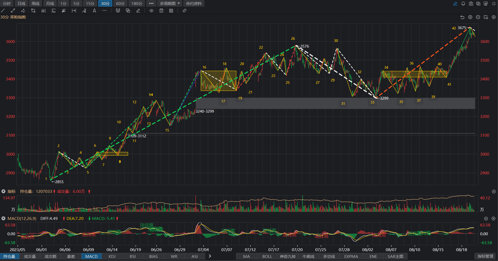

# 0003.笔-线段-中枢的具体参数及菜粕指数1-42复盘.md

### 1.笔-线段-中枢的具体参数

#### 1.1 笔的参数

* 笔的参数为：第一档线段，实线，黄色的倒数第五个。

#### 1.2 线段的参数

* 线段：第二档线段，虚线段，白色的第一个，满足至少有三笔以上的重合部分，即成为线段。
* 线段的进入段：第二档线段，虚线段，倒数第五个绿色。
* 线段的背驰段：第二档线段，虚线段，上涨背驰段（红色），下跌背驰段（蓝色）。

#### 1.3 中枢的参数

1. 30min笔中枢参数：第一档线段，实线，黄色倒数第五个；

2. 30min笔中枢以上的中枢：标准情况下，有9笔即可升级为更高级别的中枢，实线，第二档线段，黄色倒数第五个。

3. 进入段：30min笔中枢进入段，实线，第一档线段，倒数第五个绿色；30min笔中枢以上的中枢进入段：虚线段，第二档线段，倒数第五个绿色。
4. 离开段：30min笔中枢离开段，实线，第一档线段，倒数第五个绿色；30min笔中枢以上的中枢离开段：虚线段，第二档线段，倒数第五个绿色。
5. 背驰段：30min笔中枢或笔的背驰段，实线，第一档线段，倒数第五个红色（上涨），蓝色（下跌）;30min笔中枢以上的中枢背驰段：虚线段，第二档线段，倒数第五个红色（上涨过程中），蓝色（下跌过程中）。

#### 1.4 总结

30min上由笔组合成出的线段，是我看盘的最小构件单位。在30min级别上，由线段构造出来的更高级别的线段或中枢，即为最终级别。具体参见下图。该级别采用第三档线段，虚线段。进入段，绿色，上背驰段红色，下背驰段蓝色。

### 2.菜粕指数1-42复盘

行情首先由1-2的向上一笔，开始发动。2-5，构成的向下的线段，完成了对1-2笔的终结。当行情从5走到点位8时形成了新的线段5-8，终结了线段2-5，意味开启新的上涨，点位5即位第二类买点。8-9的向下一笔，意味着产生了笔中枢6789，当在向上笔9-10的过程中，超过点位8时，以为着可能出现背驰段和离开段两种情况，由后文可知，并未出现背驰段，9-14为离开段。从9-10一笔到9-14，因为高点比前一个高点高，低点比前一个低点高，且10-11，11-12，12-13无交集，因此判断为强上涨，当点位15出现的时候，比13要低，因此14-15可能是作为新的一笔，展开震荡或者是演化成向下线段，来终结笔中枢6789的9-14的离开段。需要强调一点，**向上线段原则上只能由向下线段终结，反之亦然**（eg：2-5,5-14），**向上笔只能由向下笔终结，反之亦然**(eg :7-8,8-9)。这是从结构的稳定性上来判断，技术分析的本质就是资金流过的痕迹，资金反复在某个特殊位置上下波动，这个位置就积蓄了大量的能量。但也有例外情况，比如笔1-2，笔14-15，笔15-16，这三个笔的力度就明显相当于线段的力度，要特别注意。**出现某笔当成线段的情况，一旦创出新高，说明主力很强势。那可以当线段使用的笔，往往是新的中枢或者是线段与线段之间的重要构件。** 